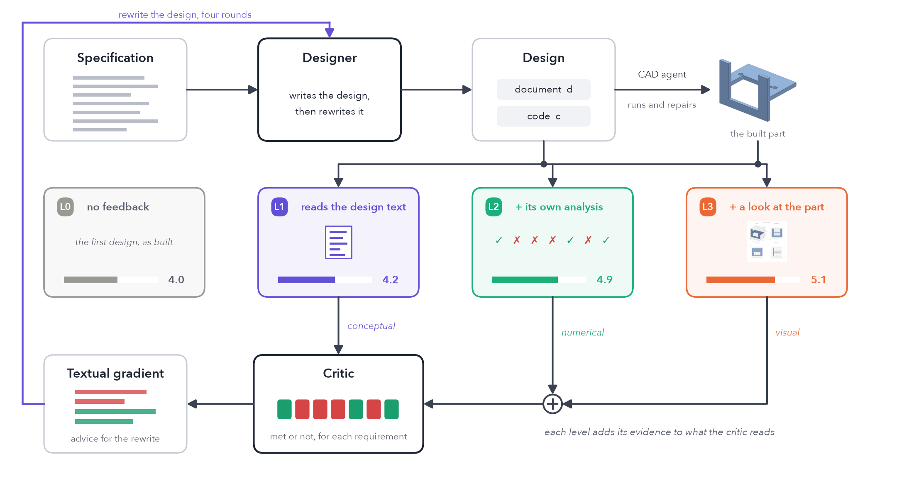

# DesignGrad

**Conceptual, numerical and visual feedback for a local CAD coding agent.**
Paper: [`paper/DesignGrad_v4.pdf`](paper/DesignGrad_v4.pdf) (source: `paper/draft_v4.md`), written for the Kaggle Gemma 4 Developer
Agent Paper Track.

One open model, **Gemma 4 26B-A4B**, runs offline on a laptop with Ollama and plays every role. A designer writes a design document
and CadQuery code, a CAD agent builds the part, a critic reviews the design, and the critique becomes TextGrad-style textual
gradients that rewrite the design. The levels differ only in what the critic reads:

| Level | What the critic reads | Requirements met (of 7) |
|---|---|---|
| L0 | nothing: the first design, as built | 4.0 |
| L1 conceptual | the design document | 4.2 |
| L2 numerical | + measurements from analysis code the agent writes itself | 4.9 |
| L3 visual | + a review of four rendered views of the part | 5.1 |

Mean of nine runs (three parts, three repeats), scored by independent tests that the agents never see. The agent's own analysis code
is itself tested: it is run on a control part, a one-millimetre cube, and a check that still "finds" a hole or a wall there is sent
back.



## What is in this repository

```
designgrad/   the loop (loop.py), the persistent agent (agent.py), all prompts (prompts.py), the Ollama client (llm.py),
              isolated execution of model-written code (sandbox.py, cad_runner.py, sim_runner.py), rendering (render.py)
problems/     P01..P10: spec.md (shown to the agents); hidden_tests.py and meta.json (the independent tests, never shown);
              reference.py (a correct design)
eval/         the independent tests' library, scoring (v4_analyze.py), record-replay check (replay.py), freeze manifests (freeze.py)
paper/        the paper, its figures and the scripts that draw them from the records
runs/         the records of every reported run: each model call, design document, CAD and analysis program, built part,
              measurement report, control run, render, critique and keep/reject decision, per round
```

Records included:

| Folder | What |
|---|---|
| `runs/v6_s0`, `v6_s1000`, `v6_s2000`, `v6_all` | the nine main runs per level (shelf bracket, enclosure base, motor mount) and their summary |
| `runs/v6x_s0`, `v6x_s1000`, `v6x_all` | the further parts of Section 4.5, including the two runs the paper leaves out and names |
| `runs/v4_s0`, `v5_s0` | first passes with earlier versions of the loop; their faults led to the revisions listed in the paper's Limitations |
| `runs/v7_s0` | the remedy for false alarms that was tried and, by a rule set beforehand, not adopted |
| `runs/v4pilot`, `v5pilot`, `v6pilot` | pilot runs on a part outside the test set (wall hook) |
| `runs/_ref` | the reference designs and plain blocks used to test the independent tests |

`FROZEN_v4.json` … `FROZEN_v7.json` hold SHA-256 hashes of the specifications, the independent tests and the loop code at the start
of each run. Seed 0 of the main runs started from the state in `FROZEN_v6.json`; the other runs used the state in `FROZEN_v7.json`
(the code in this repository) with the flag `--ladder v6`.

## Hardware and software used

- Apple M1 Max, 10 CPU cores, 32 GB unified memory, no discrete GPU; macOS 26.2.
- Ollama 0.32.1 with `gemma4:26b` (26b-a4b-it, q4_K_M, digest 001e5dafc3c7). Temperature 0.3, thinking off, context 24,576.
- Python 3.12.8; exact package versions in `requirements.txt` (CadQuery 2.8.0, trimesh 5.2.0, VTK 9.6.2, ...).
- Everything runs offline. No cloud model is called by the system.

## Install

```bash
ollama pull gemma4:26b
uv venv --python 3.12 .venv && uv pip install --python .venv/bin/python -r requirements.txt
```

## Check the release without running the model

```bash
.venv/bin/python eval/validate_refs.py                 # every reference design passes its independent tests; plain blocks fail
.venv/bin/python eval/freeze.py --check FROZEN_v7.json # specifications, tests and loop code are unchanged
.venv/bin/python eval/v4_analyze.py runs/v6_s0 runs/v6_s1000 runs/v6_s2000 --out runs/v6_all   # rescore the main runs (Table 1)
.venv/bin/python eval/v4_analyze.py runs/v6x_s0 runs/v6x_s1000 --out runs/v6x_all              # rescore the further parts
DG_LADDER=v6 .venv/bin/python eval/replay.py runs/v6_s0 L2 P03   # replay one run: recorded answers through the current code
.venv/bin/python paper/figs/v4_examples.py             # checks every quote in the example figures against the records, redraws them
.venv/bin/python paper/figs/make_figs_v6.py            # redraws the other figures from the records
```

The replay replaces Gemma by the recorded answers and runs everything else for real (prompt building, CAD and analysis code,
scoring, keep/reject). It was byte-identical on the machine that made the records. Error messages shown to the agents contain the
absolute path of the Python environment, so on another machine a prompt that quotes such an error differs in that path.

## Run the agents

```bash
.venv/bin/python -m designgrad.run --ladder v6 --problems P01 --levels L0 L1 L2 L3 --out runs/x
.venv/bin/python eval/v4_analyze.py runs/x --out runs/x
```

About 1 minute (L0) to 15–25 minutes (L2, L3) per part on the hardware above. `DG_SEED` sets the sampling seed. The scripts that
produced the reported runs are `runs/v6_run.sh` and `runs/v6_extra*.sh`. More commands: `entry_points.md`.

## Side effects and assumptions

- `designgrad.run` deletes and recreates `runs/<out>/<level>/<problem>/` for every run it starts; finished runs (with
  `summary.json`) are skipped unless `--force`.
- Model-written code runs in a separate Python process (`python -I`) with a timeout, in a fresh folder with read-only copies of
  the part files; it is not otherwise sandboxed. Run it on a machine you do not mind it running on.
- Levels L1–L3 start from the L0 design in the same output folder; run L0 first.
- Paths are relative to the repository root (`SETTINGS.json`).
- `paper/build_pdf.py` prints the PDF with a local Chrome.

## Earlier ladders

The flags `--ladder v2`, `v4`, `v5` and `v7` select earlier versions of the loop, kept so that their records replay unchanged.
`eval/` and `designgrad/` also hold scripts and modules from those versions (for example a MuJoCo scenario level that is not part of
the paper). Development records older than `v4` are not in this repository.

## License and disclosure

Apache License 2.0 (`LICENSE`). Third-party software and its licenses: `NOTICE`.

Claude (Anthropic) helped write the code, the problems, the independent tests and the paper, and scored the runs outside the loop.
Claude is not part of the system: every agent in the loop is Gemma 4, running offline.
