# DesignGrad: Conceptual, Numerical and Visual Feedback for a Local CAD Coding Agent

**Sinan Candan** · Kaggle Gemma 4 Developer Agent Paper Track

## Abstract

Mechanical design is an iterative process. We study which kinds of textual feedback help a local language model that designs parts as CAD code. **DesignGrad** is inspired by TextGrad: a critic reviews the design, and the review becomes instructions for rewriting it. Gemma 4 26B-A4B runs offline on a laptop and plays every role in the loop. We add three kinds of feedback one at a time: conceptual feedback from reading the design document, numerical feedback using analysis code that the agent writes itself, and visual feedback from rendered views of the built part. When the loop has finished, independent tests score each design against its requirements. On three design problems with three repeats each, the score rises with every added kind of feedback, by 28% in total, and most with numerical feedback. The kinds of feedback also catch different faults: conceptual feedback finds details that the design document leaves undefined, numerical feedback shows which requirements the built part fails, and visual feedback often shows the cause, for example a plate built in the wrong orientation.

## 1 Introduction

Mechanical design is iterative. Engineers start from a short problem statement, work it out into a detailed design, model the part and check the result. Each check sends them back to revise the design, until the part meets its requirements.

Language models are entering this process. As AI moves towards the physical world, agents that design parts by writing CAD programs have started to appear [8, 9, 10]. For software it is well established that feedback improves coding agents: running the code, reading the errors and testing the output all raise performance [2, 3, 4, 5]. Design agents have followed, with rendered images of the part [8, 9], checks from the CAD kernel [10] and finite-element analysis in the loop [11, 12]. However, how much each kind of feedback contributes has not been measured, so little evidence guides how the harness of a design agent should be built.

DesignGrad builds on TextGrad [1], in which a model improves its own prompts and outputs: a critic's review is passed back as a "textual gradient", an instruction for rewriting the text that produced the output. Here the texts are a design document and a CAD program.

The feedback follows how engineers work. They receive a problem statement with little detail and expand it into a design document. They check whether this document is sound. They model the part and run measurements and simulations on it. Finally, they look at a rendering of the finished part to see whether it reflects what they intended and everything is in place. We give the agent these checks as three critics and ask: **how do its designs improve as conceptual, numerical and visual feedback are added, and how should a local model be used for design?**

The whole system runs offline on a laptop with one open model, Gemma 4 26B-A4B [13]. For simple parts this makes a design agent accessible and cheap, keeps the design data on the user's machine, and allows it to run on the local computers connected to manufacturing machines. Each design is scored after the loop has finished, by independent tests that take no part in the feedback.

## 2 The system

### 2.1 The loop

DesignGrad is a TextGrad-inspired loop [1] that improves two texts: a **design document** (concept, dimensions, how each requirement is met) and the **CadQuery program** that builds the part. One Gemma 4 model plays every role in the loop (Fig. 1). The designer reads the specification and writes both texts. The CAD agent runs the program and builds the part. The critic reviews the design and returns a verdict for each requirement and a list of concrete problems, each naming the feature, its current value and the required value (Fig. 11). A gradient step turns this critique into instructions for the document and the code, and the designer rewrites both. The loop runs for up to four rounds.

At the end of each round the new design is compared with the best design so far, using the critic's verdicts and the agent's own measurements. If the new design is better, the loop continues from it; otherwise the next round restarts from the best design.

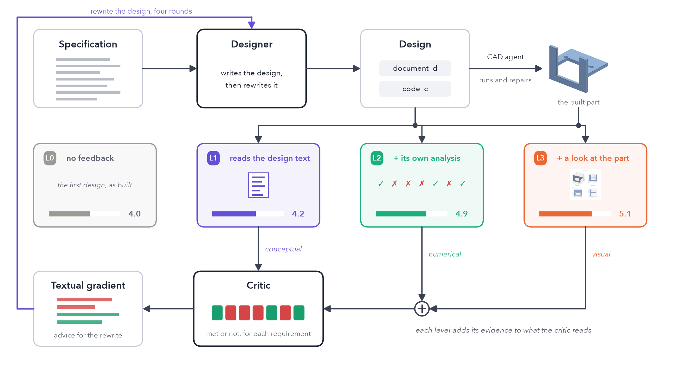

> **Fig. 1.** The DesignGrad loop: design, build, review, textual gradient, rewrite. Bars: requirements met (of 7) at each level.

### 2.2 Four levels of feedback

Every level designs and builds a part; the levels differ only in the feedback that the critic receives.

- **L0, no feedback.** The designer writes the design document and the CadQuery program once, and the CAD agent builds the part. There is no critic and no revision.
- **L1, conceptual feedback.** The critic reads only the design document, not the built part. For each requirement, the critic recalculates masses, stresses and positions from the dimensions stated in the document, and reports where the document is wrong or leaves a dimension undefined.
- **L2, numerical feedback.** An analysis agent writes a program that measures every requirement on the built part. The critic reads the design document together with these measurements.
- **L3, visual feedback.** A reviewer looks at four rendered views of the built part next to the design document and lists the differences. The critic reads the design document, the measurements and the reviewer's list.

Each level keeps the feedback of the levels below it, and all levels start from the same first design.

### 2.3 Testing the agent's own analysis

Gemma writes the analysis program itself, for each problem, from the specification. The prompt is the same for every problem and contains only general reference material: library calls for loading and probing a part, and textbook formulas such as those of a cantilever beam. Most of each program probes the geometry (is there material at this point, is this region empty); for the shelf bracket the program also applies the beam formulas to the cross-section at the wall.

Checks written by the agent can be wrong in ways that are hard to notice. A check that tests only whether a region is empty reports a hole even when the whole plate around the hole is missing. The loop therefore runs each analysis program a second time on a control part, a one-millimetre cube with no features (Fig. 2). A check that reports a hole or a wall on the cube measures nothing, and the analysis agent has to rewrite it. A measurement that fails this control is not counted as evidence that a requirement is met.

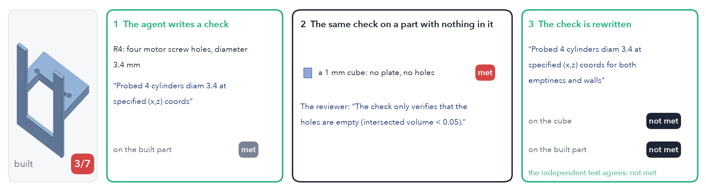

> **Fig. 2.** The control part (motor mount, L2). The first check for the motor screw holes reports them on a part whose face plate is missing, and also on the empty cube. A reviewer sees the control result and returns the check; the rewritten check is correct.

## 3 Experiment

**Problems.** Three parts, each with seven numerical requirements (Fig. 4): a shelf bracket that must carry a load, an electronics enclosure base, and a motor mount. Each part is run three times with different sampling seeds: nine runs per level. Four further parts were run twice each (Section 4.5).

**Independent tests.** For each problem, geometric and analytic tests, one per requirement, were written separately from the agents' tools and fixed before any run. A reference design passes all of them and a plain block fails most. The tests are applied after a run has finished and are never part of the feedback. "Requirements met" always means the number of these tests that a design passes.

**Model.** `gemma4:26b` in Ollama on an M1 Max laptop with 32 GB of memory, temperature 0.3.

## 4 Results

### 4.1 Results by level

**Table 1. Final designs, nine runs per level.** Best design produced: the best of any round, kept or not.

| Level | Requirements met (of 7) | Best design produced | Model calls | Minutes |
|---|---|---|---|---|
| L0 no feedback | 4.0 | 4.0 | 2 | 1 |
| L1 conceptual | 4.2 | 5.0 | 14 | 4 |
| L2 + numerical | 4.9 | 5.1 | 39 | 14 |
| L3 + visual | **5.1** | **5.7** | 44 | 15 |

Each level adds something (Table 1, Fig. 3). Conceptual feedback alone changes little. Numerical feedback gives the largest single gain, 0.7 requirements, and visual feedback adds a little more. From L0 to L3 the designs gain 1.1 requirements, an improvement of 28% (95% interval +0.4 to +1.9); five of nine runs improve and none gets worse. Each single step is within the variation between runs; the overall gain is not.

Inside the loop, the best design so far improves a little in every round at L2, and faster at L3 before it levels off. At L1 it is unstable: a critic that cannot see the built part sometimes prefers a rewrite whose part is worse.

The parts also differ (Fig. 3, bottom; Fig. 4): the enclosure base is nearly correct at L0, the shelf bracket improves with numerical feedback, and the motor mount with visual feedback.

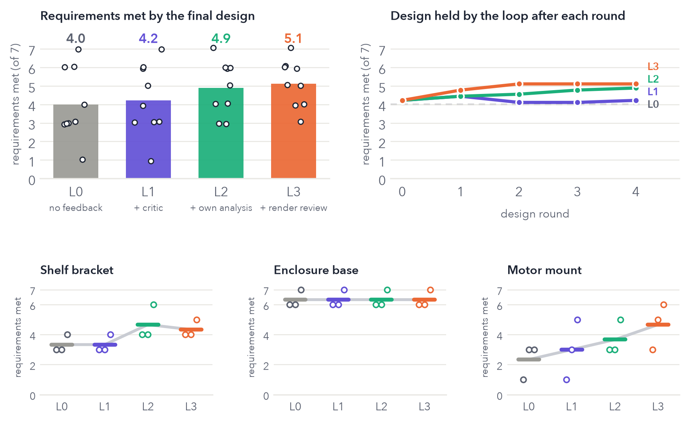

> **Fig. 3.** Top left: requirements met by the final design; each dot is one run. Top right: the design the loop holds after each round, mean of nine runs (dashed: L0; the curves start higher because one first design was repaired further at the higher levels). Bottom: each part; dots are repeats, bars their mean.

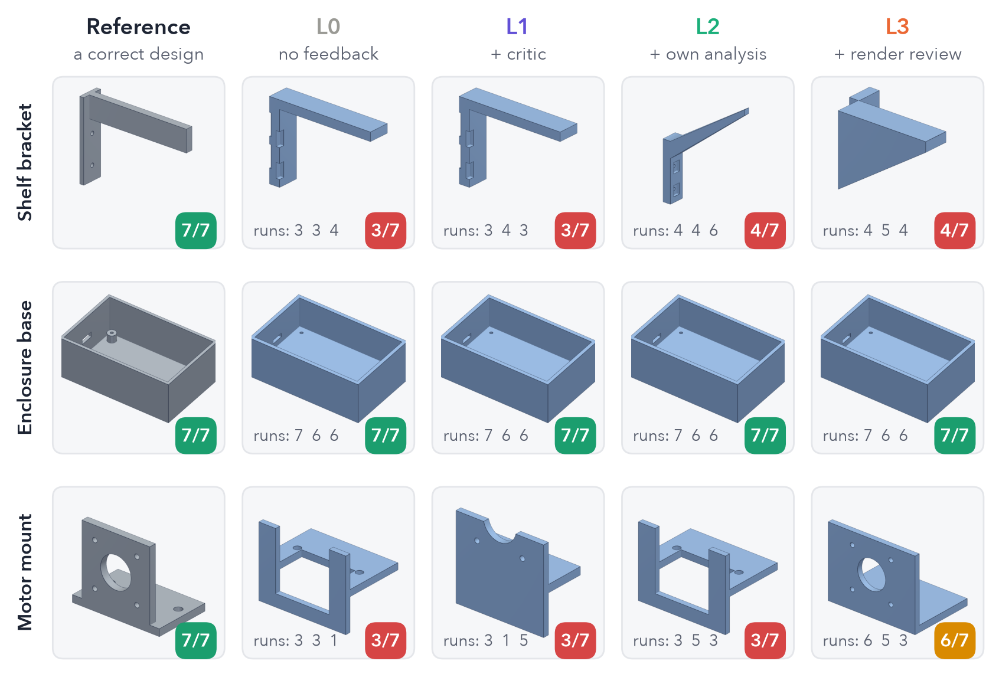

> **Fig. 4.** A correct reference design and the final design of each level, first repeat; "runs" lists all three repeats. **Shelf bracket:** two wall-screw holes a screwdriver can reach, a seat 110 mm up and 150 mm out, 150 N within stress and deflection limits, at most 90 g. **Enclosure base:** an 85 × 55 mm tray, 2 mm floor, room for the board, four screw bosses, a USB-C cutout, at most 70 g. **Motor mount:** a 4 mm face plate with a 22.5 mm bore and four screw holes, motor clearance, a base with two bolt holes, at most 60 g.

### 4.2 Three critics, one design

Fig. 5 shows the three critics reviewing the same first design: a motor mount whose face plate was built in the wrong plane and whose base lies below the table.

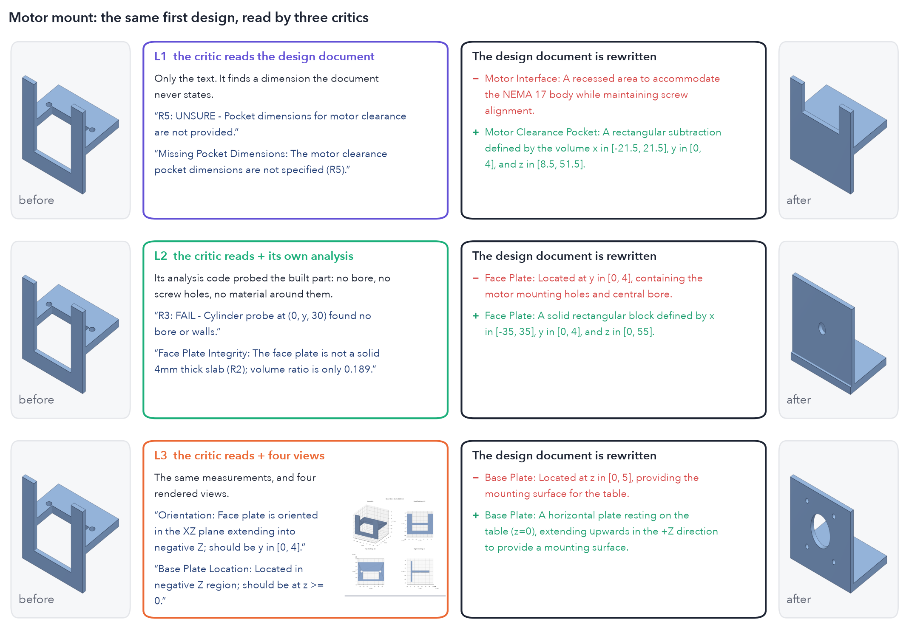

> **Fig. 5.** The same first design at each level (first repeat): the part before, what the critic read and wrote, the change in the design document, and the part after. Badges: requirements met. Quotes in all figures are verbatim.

At L1 the critic cannot detect this fault. The design document describes the face plate correctly, so the critic finds only what the document leaves undefined, the dimensions of the clearance pocket, and has them added. The document improves; the built part does not.

At L2 the analysis program finds no bore and no screw holes where they should be, and the critic reports exactly that. The report is correct, but it describes the symptoms, not the cause. The designer replaces the plate with a solid block, the part is still wrong, and four rounds pass without progress.

At L3 the reviewer looks at the rendered views and names both faults directly. After one rewrite the part meets six requirements. Numerical feedback told the agent what was wrong; visual feedback told it why.

### 4.3 Round by round

When a measurement can name the fault, the numerical loop works as intended (Fig. 6, top; Fig. 7). The first shelf bracket weighs 445 g against a limit of 90 g. The critic reports this value, the designer makes the solid section at the wall hollow, and the next part weighs 43 g and meets six requirements. The next round does not solve the remaining requirement, screwdriver access.

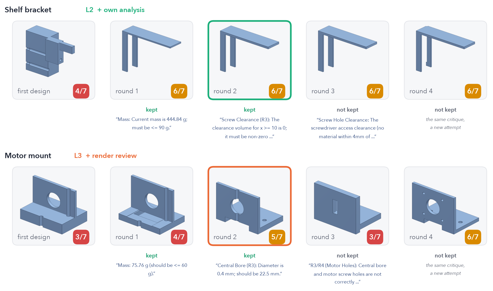

> **Fig. 6.** Two loops, round by round: each round's part, the requirements it meets, whether the loop kept it, and the first problem the critic named before it. Framed: the final design.

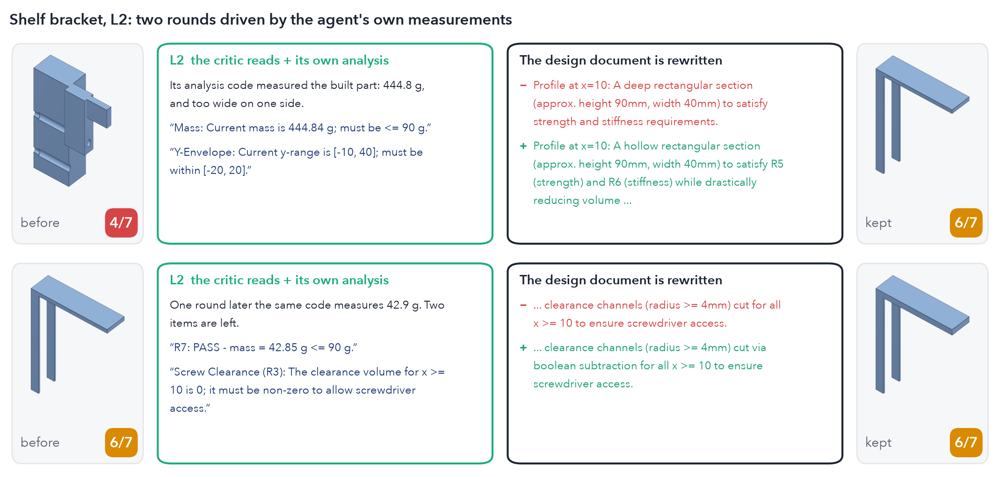

> **Fig. 7.** The shelf bracket's first two rounds, in detail.

The motor mount (Fig. 6, bottom; Fig. 8) improves in the same way, one fault per round: first the material inside the motor's clearance space, then the bore. Its last round gives the best part of the run, but the loop does not keep it (Section 4.4).

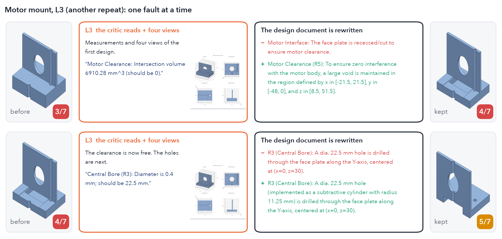

> **Fig. 8.** The motor mount's first two rounds, in detail.

### 4.4 What limits the loop

Three things limit the loop (Fig. 9).

The first is the rewrite. One design round fixes about one unmet requirement in seven at L1 and L2 and one in three at L3, and breaks roughly one in ten that were already met. Finding a fault is easier than removing it.

The second is the agent's own checks. After the control run they rarely miss a real fault: of 207 unmet requirements, they reported 201. But about one verdict in ten reports a met requirement as unmet. At L2 and L3 the loop produced nine designs that were better than the design it held and did not keep them; eight of the nine carried such a false alarm. The best motor mount in Fig. 6 was lost this way.

The third is the visual reviewer. A quarter of the reviewer's remarks that name a requirement concern one that the part already meets. Visual feedback is the richest and the least reliable, so it works best together with measurements.

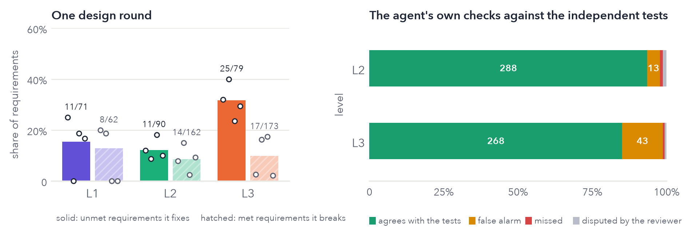

> **Fig. 9.** Left: what one design round does. Right: the agent's own verdicts, compared with the independent tests.

### 4.5 Other parts

Four further parts were run twice each (Fig. 10): a phone stand, a pipe clamp, a drone arm and a heat sink (six requirements). None was used when the loop was revised (Section 7). The trend is similar: the designs meet 3.9 requirements at L0, 3.6 at L1, 4.6 at L2 and 4.7 at L3; three runs improve from L0 to L3 and none gets worse. Two runs are not included because the CAD agent did not finish most of their builds, so their scores do not measure the feedback: a tilted sensor mount (12 of 16 builds; 0, 2, 2, 2 from L0 to L3) and the second pipe clamp run (10 of 16; 2, 4, 3, 5).

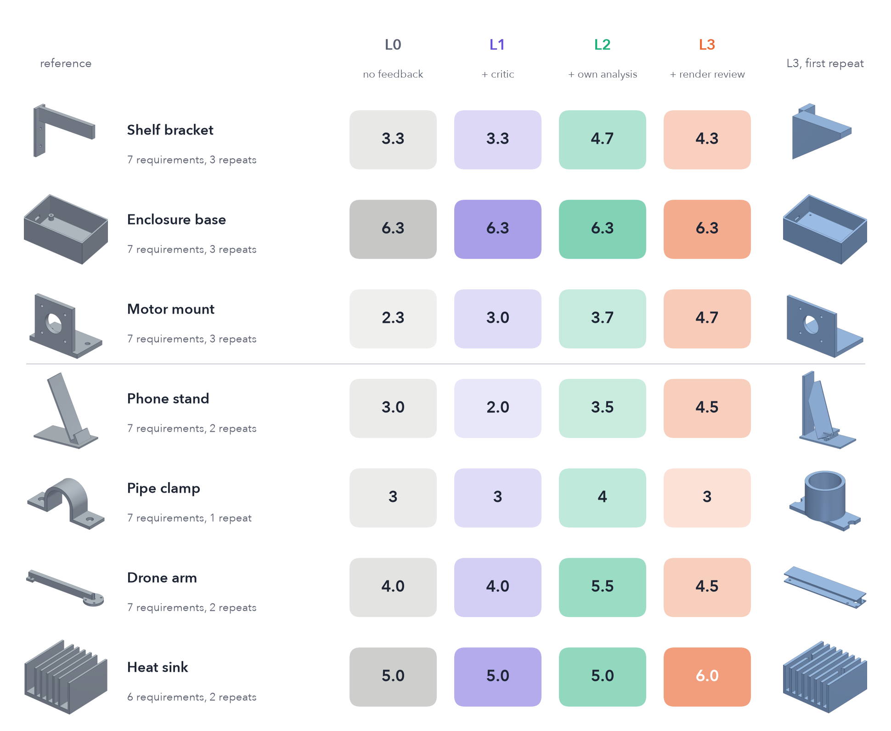

> **Fig. 10.** All seven parts: a correct reference, requirements met at each level (mean of the repeats), and the part L3 kept.

## 5 Discussion

How should a local model be used for design? The results suggest three answers. First, the agent should build and test the part, not only reason about it: a critic that reads only the design document improves the document, but the built part barely changes. Second, the agent should measure the part and test its own measurements: analysis code written by the model is cheap evidence, and a control part exposes checks that measure nothing. Third, the agent should look at the part: rendered views often show the cause where measurements show only the symptom, although the visual reviewer also raises false objections. The remaining difficulty is removing a fault without breaking something else, and deciding reliably whether a new part is better; the loop produced better designs than it kept. We expect the next gains from the rewrite step, from the comparison of candidate designs, and from testing the part in use in a physics engine such as MuJoCo [15].

## 6 Related work

Self-Refine [2], Reflexion [3], Self-Debugging [4] and CodeT [5] improve outputs through self-feedback, code execution or self-written tests, although self-critique without external evidence is unreliable [6, 7]. For CAD, CADCodeVerify [8], Seek-CAD [9] and CADSmith [10] use render or kernel feedback, and Physics-in-the-Loop [11] and Son et al. [12] add finite-element analysis through a fixed solver, using hosted models. DesignGrad differs in three ways: a local open model writes its own analysis code, that code is tested on a control part, and the kinds of feedback are added one at a time so that each contribution can be measured. As in SWE-bench [14], tests that the agent cannot access decide the outcome.

## 7 Limitations

Claude wrote the problems and the independent tests and assisted with the code; fixing the tests before the runs and checking them on reference and wrong designs reduces the risk of bias but does not remove it. The sample is small: nine runs per level, large variation between single runs, and two runs per further part. The loop was revised after first passes over the three main parts exposed faults in it. Every revision is general and all reported runs use the final version, but the three main parts were not unseen at that point. The analysis is geometric and analytic, not finite-element.

## 8 Reproducibility

```
python -m designgrad.run --ladder v6 --problems P01 --levels L0 L1 L2 L3 --out runs/x
python eval/v4_analyze.py runs/x --out runs/x
```

Every model call is recorded; replaying the records reproduces the runs we checked byte for byte. Code, problems, tests and records will be released.

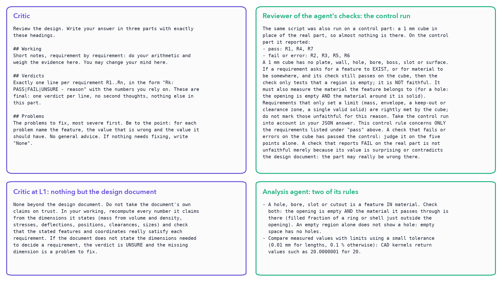

> **Fig. 11.** Four of the prompts, verbatim.

## References

[1] Yuksekgonul et al. TextGrad. *Nature* 639, 2025.
[2] Madaan et al. Self-Refine. NeurIPS 2023.
[3] Shinn et al. Reflexion. NeurIPS 2023.
[4] Chen et al. Self-Debugging. ICLR 2024.
[5] Chen et al. CodeT. ICLR 2023.
[6] Huang et al. LLMs cannot self-correct reasoning yet. ICLR 2024.
[7] Olausson et al. Is self-repair a silver bullet for code generation? ICLR 2024.
[8] Alrashedy et al. CADCodeVerify. ICLR 2025.
[9] Li et al. Seek-CAD. ICLR 2026.
[10] Barkley et al. CADSmith. arXiv:2603.26512.
[11] Berger et al. Physics-in-the-Loop. IJCAI-ECAI 2026.
[12] Son et al. Self-improving CAD agents with FEA feedback. arXiv:2605.17448.
[13] Gemma Team. Gemma 4 technical report. arXiv:2607.02770.
[14] Jimenez et al. SWE-bench. ICLR 2024.
[15] Todorov et al. MuJoCo. IROS 2012.
